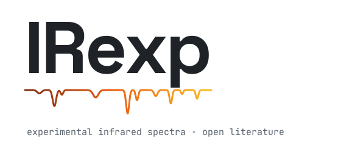

<p align="center">
  
</p>

<p align="center">
  <a href="https://huggingface.co/datasets/ilkhamfy/IRexp"></a>
  <a href="https://doi.org/10.5281/zenodo.24117617"></a>
  
</p>

Experimental infrared spectra are scarce in open, machine-readable form. Most of them sit as band lists in the text of published papers. IRexp extracts these band lists from open-access literature and links them to molecular structures.

## Data

| | Records |
|---|---:|
| Experimental IR band lists | 230,946 |
| Linked to a structure (tiers A–D) | 96,973 |
| Formula or HRMS matched (tiers A–B) | 52,843 |
| Dataset of record (`irexp_commercial.jsonl.gz`) | 190,049 |

The commercial file is packaged CC-BY-4.0 and holds 164,016 CC-BY/CC0 records plus 26,033 records from no-derivatives-licensed articles, marked `nd_source_licence`. Companion files keep their source licences: 39,000 non-commercial and 1,897 ShareAlike. All bands are within 400–4000 cm⁻¹. Each record keeps its source paper and source licence.

## Get the data

```python
import pandas as pd
from huggingface_hub import hf_hub_download

path = hf_hub_download(
    "ilkhamfy/IRexp",
    "data/irexp_commercial.jsonl.gz",
    repo_type="dataset",
)
df = pd.read_json(path, lines=True)
```

- Hugging Face: [ilkhamfy/IRexp](https://huggingface.co/datasets/ilkhamfy/IRexp)
- Zenodo archive: [10.5281/zenodo.24117617](https://doi.org/10.5281/zenodo.24117617) (concept: [10.5281/zenodo.22822284](https://doi.org/10.5281/zenodo.22822284))
- Extraction code: [IlkhamFY/spectro-agent](https://github.com/IlkhamFY/spectro-agent)

## Licence

The CC-BY file is the dataset of record. Filter on `nd_source_licence` to keep only records whose source licence permits adaptation. The non-commercial and ShareAlike files keep their source licences. Code in this repository: MIT.
